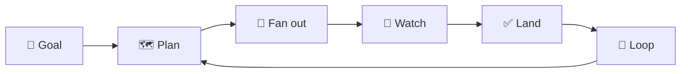
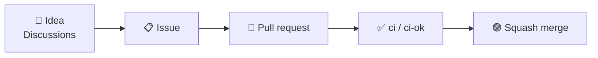

# 🐉 Aurelius

> The dragon who orchestrates every agent.

  

Aurelius takes a goal, splits it into tasks, directs the agents and checks the whole. This repo holds the premise and
the plans for orchestrating thousands of AI agents, and in time hundreds of thousands.

| | |
|---|---|
| Status | 💡 Concept |
| Code | None yet. This repo shows what can be done and how |
| License | Apache-2.0 |
| Publisher | [SoulCraft](https://soulcraft.computer) |

## The loop

| Step | What Aurelius does |
|---|---|
| 🗺️ Plan | Splits the goal into tasks small enough for one agent each |
| 🚀 Fan out | Starts as many agents as the work needs, each in its own place |
| 👀 Watch | Checks every agent on a short clock; a quiet one gets a nudge, then a restart |
| ✅ Land | Reviews each result before it joins the whole |
| 🔁 Loop | Gives failed work more effort or a stronger model, then tries again |

## The premise

| Belief | So |
|---|---|
| Agents are cheap; checking them is not | Every result is reviewed before it lands |
| One mind cannot watch thousands | Orchestrators direct orchestrators |
| Work fails | Failure raises effort or model, never silence |

## Scale

| Stage | Agents | What changes | Status |
|---|---|---|---|
| Today | tens | One orchestrator, workers in the cloud | ✅ in use |
| Next | thousands | Orchestrators of orchestrators, a shared task board, a budget per goal | ⬜ [plan](docs/PLAN.md) |
| Later | hundreds of thousands | Sampling review, automatic retries, one view of the whole | ⬜ |

## How it connects

| Repo | Role |
|---|---|
| ✦ [sage](https://github.com/SoulCraft-Org/sage) | The angel the agents help build |
| ☀️ [solar](https://github.com/SoulCraft-Org/solar-compute) · 🌋 [planetar](https://github.com/SoulCraft-Org/planetar-compute) · ⭐ [star](https://github.com/SoulCraft-Org/star-compute) | The compute the agents run on |

## Build with us

| You want to | Go to |
|---|---|
| Share an idea | [Discussions, Ideas](https://github.com/SoulCraft-Org/aurelius/discussions/categories/ideas) |
| Ask a question | [Discussions, Q&A](https://github.com/SoulCraft-Org/aurelius/discussions/categories/q-a) |
| Change the plan | A pull request on [`docs/PLAN.md`](docs/PLAN.md), signed off (`git commit -s`) |
| Read the rules | [CONTRIBUTING.md](CONTRIBUTING.md) · [GOVERNANCE.md](GOVERNANCE.md) · [CODE_OF_CONDUCT.md](CODE_OF_CONDUCT.md) |
