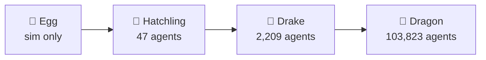
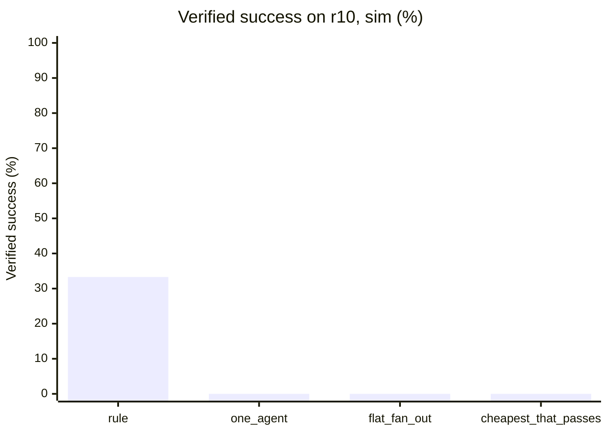
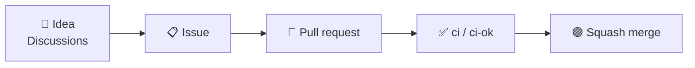

# 🐉 Aurelius

> The dragon who orchestrates every agent.

  

🧊 [The 2,209-agent tree in 3D, drag to turn](docs/img/tree.stl)

⏱️ [One run of the 47-worker tree, lighting up over time](docs/img/run.svg)

Aurelius trains one open model to direct 100,000+ agents as a tree of seats: 47 × 47 × 47 = 103,823.

> 🚧 **Design only.** Nothing is trained yet. Sources read 2026-11-22.

## 🏆 Scorecard

| Pillar | Gap today | Aurelius | Metric | First shown |
|---|---|---|---|---|
| 💰 Cheapest path to done | Multi-agent runs use about 15x chat tokens, a figure the vendor states about itself ([Anthropic](https://www.anthropic.com/engineering/multi-agent-research-system)) | Picks the cheapest worker expected to pass | Cost per verified success | 🥚 sim |
| ✅ Checked work | Unchecked agents grew errors 17.2x, against 4.4x with a central check; teams of up to 9 ([arXiv 2512.08296](https://arxiv.org/abs/2512.08296)) | A check at every tier; facts tagged seen or inferred | Error growth per tier; alarms reaching the top | 🥚 sim |
| 🔁 Never loses work | In-process teammates cannot be resumed ([Claude Code docs](https://code.claude.com/docs/en/agent-teams)) | A ledger per seat; a killed seat resumes | Resume rate | 🥚 sim |
| 🛑 Hard limits | Task states say working or failed, not what was spent ([MCP Tasks](https://modelcontextprotocol.io/specification/draft/basic/utilities/tasks), [A2A](https://a2a-protocol.org/latest/specification/)) | A budget in every order, enforced by the seat; cancel, then kill | Budget overruns: goal 0 | 🥚 sim |
| 🔌 Any agent, any model | 51 agents listed on one wire ([ACP](https://agentclientprotocol.com)); closed models bar training a rival on their outputs ([terms](https://www.anthropic.com/legal/commercial-terms)) | One wire (ACP), open Apache-2.0 base models, no closed model writes or grades training data ([usage policy](https://www.anthropic.com/legal/aup)) | Harnesses passing the adapter test | 🐣 real |
| 🔓 Open and proven | No public cost-per-success score found (our search) | Open weights and a public Ladder | Rungs passed, in public | 🐣 real |

## 🐉 How to train your dragon

Each rung's recorded runs become the next rung's stand-ins ([training](docs/training.md)).

## 📊 Scoreboard

First scores, 2026-11-23, from [one `ladder.yml` run](https://github.com/SoulCraft-Org/aurelius/actions/runs/45107701093) on commit `9d525ad`. Source: [`ladder/scores.json`](ladder/scores.json).

**Verified success on r10, the only rung with any verified run (%)**

**Verified success by rung (%)**

| Seat | r10 | r47 | r2209 | r103823 |
|---|---|---|---|---|
| `rule` | 33 | 0 | 0 | 0 |
| `one_agent` | 0 | 0 | 0 | 0 |
| `flat_fan_out` | 0 | 0 | 0 | 0 |
| `cheapest_that_passes` | 0 | 0 | 0 | 0 |

**r103823, 1 seed**

| Seat | Critical steps | Error growth per tier | Alarms reaching the top (%) |
|---|---|---|---|
| `rule` | 12 | 0.91 | 75.5 |
| `one_agent` | 103,823 | n/a | 28.5 |
| `flat_fan_out` | 1 | n/a | 77.3 |
| `cheapest_that_passes` | 1 | n/a | 77.3 |

Cost per verified success exists for one row: `rule` on r10, 131 credits. Every other row has no verified success, so it shows n/a.

**Finding:** a run is verified when it scores 95% or more. Only the rule seat gets there, in 1 of 3 runs on r10. No seat gets there with 47 agents or more. These use assumed worker rates and 5 credits per agent. Closing that gap is the goal of training, not a result.

- Every score is sim.
- Worker rates are assumed until fitted from real runs.
- In sim, resume rate is a determinism check.

## 📚 Read more

| Page | What it holds |
|---|---|
| [`docs/design.md`](docs/design.md) | The seat: loop, 5 actions, order, reply |
| [`docs/training.md`](docs/training.md) | Base model, method, reward |
| [`docs/ladder.md`](docs/ladder.md) | The Lair, 4 rungs, 8 metrics |
| [`docs/sources.md`](docs/sources.md) | Every idea and number, with its source |
| [`spec/aurelius.json`](spec/aurelius.json) | The one spec the docs read |
| [`docs/PLAN.md`](docs/PLAN.md) | The plan |

## How it connects

| Repo | Role |
|---|---|
| ✦ [sage](https://github.com/SoulCraft-Org/sage) | The angel the agents help build |
| ☀️ [solar](https://github.com/SoulCraft-Org/solar-compute) · 🌋 [planetar](https://github.com/SoulCraft-Org/planetar-compute) · ⭐ [star](https://github.com/SoulCraft-Org/star-compute) | The compute the agents run on |

## Build with us

| You want to | Go to |
|---|---|
| Share an idea | [Discussions, Ideas](https://github.com/SoulCraft-Org/aurelius/discussions/categories/ideas) |
| Ask a question | [Discussions, Q&A](https://github.com/SoulCraft-Org/aurelius/discussions/categories/q-a) |
| Change the plan | A pull request on [`docs/PLAN.md`](docs/PLAN.md), signed off (`git commit -s`) |
| Read the rules | [CONTRIBUTING.md](CONTRIBUTING.md) · [GOVERNANCE.md](GOVERNANCE.md) · [CODE_OF_CONDUCT.md](CODE_OF_CONDUCT.md) |
