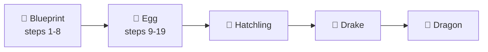

# 🗺️ Roadmap: Aurelius

> Status read from the step issues on 2026-11-23. ✅ closed, ⬜ open, ➡️ moved.

## 🧭 Phases

## 📘 Blueprint

| Step | Title | Issue | Status |
|---|---|---|---|
| 1 | Research map | [#3](https://github.com/SoulCraft-Org/aurelius/issues/3) | ✅ |
| 2 | The spec | [#4](https://github.com/SoulCraft-Org/aurelius/issues/4) | ✅ |
| 3 | Design: the seat | [#5](https://github.com/SoulCraft-Org/aurelius/issues/5) | ✅ |
| 4 | Training | [#6](https://github.com/SoulCraft-Org/aurelius/issues/6) | ✅ |
| 5 | Ladder | [#7](https://github.com/SoulCraft-Org/aurelius/issues/7) | ✅ |
| 6 | Hero: animated tree | [#8](https://github.com/SoulCraft-Org/aurelius/issues/8) | ✅ |
| 7 | Front door | [#9](https://github.com/SoulCraft-Org/aurelius/issues/9) | ✅ |
| 8 | Public roadmap | [#10](https://github.com/SoulCraft-Org/aurelius/issues/10) | ✅ |

## 🥚 Egg

| Step | Title | Issue | Status |
|---|---|---|---|
| 9 | Lair core: event loop | [#11](https://github.com/SoulCraft-Org/aurelius/issues/11) | ✅ |
| 10 | Tasks | [#12](https://github.com/SoulCraft-Org/aurelius/issues/12) | ✅ |
| 11 | Stand-in workers | [#13](https://github.com/SoulCraft-Org/aurelius/issues/13) | ✅ |
| 12 | Seat + rule-based seat | [#14](https://github.com/SoulCraft-Org/aurelius/issues/14) | ✅ |
| 13 | Ledger | [#15](https://github.com/SoulCraft-Org/aurelius/issues/15) | ✅ |
| 14 | Baselines | [#16](https://github.com/SoulCraft-Org/aurelius/issues/16) | ✅ |
| 15 | The 8 metrics | [#17](https://github.com/SoulCraft-Org/aurelius/issues/17) | ✅ |
| 16 | Ladder runner | [#18](https://github.com/SoulCraft-Org/aurelius/issues/18) | ✅ |
| 16b | Honest metrics | [#39](https://github.com/SoulCraft-Org/aurelius/issues/39) | ✅ |
| 17 | Quality page learns the code | [#19](https://github.com/SoulCraft-Org/aurelius/issues/19) | ✅ |
| 18 | First scores, sim | [#20](https://github.com/SoulCraft-Org/aurelius/issues/20) | ✅ |
| 19 | Untrained Qwen3.5-9B seat | [#21](https://github.com/SoulCraft-Org/aurelius/issues/21) | ➡️ moved to Hatchling: the seat code is ready; the score runs on our own GPUs |

## 🐣 Hatchling

| Step | Title | Issue | Status |
|---|---|---|---|
| 20 | Fix the map-then-check crash | [#59](https://github.com/SoulCraft-Org/aurelius/issues/59) | ⬜ |
| 21 | Seed splits, a version stamp, a rates flag | [#61](https://github.com/SoulCraft-Org/aurelius/issues/61) | ⬜ |
| 21b | Training doc and roadmap match plan 2 | [#62](https://github.com/SoulCraft-Org/aurelius/issues/62) | ⬜ |
| 21c | The tree in 3D | [#63](https://github.com/SoulCraft-Org/aurelius/issues/63) | ⬜ |
| 22 | Lair Env: reset, act, reward | [#64](https://github.com/SoulCraft-Org/aurelius/issues/64) | ⬜ |
| 23 | Any endpoint, locked tool calls, the credit ledger | [#65](https://github.com/SoulCraft-Org/aurelius/issues/65) | ⬜ |
| 24 | Move 3: sweep the rule seat | [#66](https://github.com/SoulCraft-Org/aurelius/issues/66) | ⬜ |
| 25 | Serve the student, with the guard | [#67](https://github.com/SoulCraft-Org/aurelius/issues/67) | ⬜ |
| 26 | Moves 1 + 2: the untrained seat | [#68](https://github.com/SoulCraft-Org/aurelius/issues/68) | ⬜ |
| 27 | Move 4: evolve the seat prompt | [#69](https://github.com/SoulCraft-Org/aurelius/issues/69) | ⬜ |
| 28 | The Library | [#70](https://github.com/SoulCraft-Org/aurelius/issues/70) | ⬜ |
| 29 | Real workers | [#71](https://github.com/SoulCraft-Org/aurelius/issues/71) | ⬜ |
| 30 | Record real runs, fit the Lair | [#72](https://github.com/SoulCraft-Org/aurelius/issues/72) | ⬜ |
| 30b | A recorded run, replayed (4D) | [#73](https://github.com/SoulCraft-Org/aurelius/issues/73) | ⬜ |
| 30c | The viewer (5D) | [#74](https://github.com/SoulCraft-Org/aurelius/issues/74) | ⬜ |
| 31 | Lessons: the best runs as examples | [#75](https://github.com/SoulCraft-Org/aurelius/issues/75) | ⬜ |
| 32 | Move 5: LoRA tune, rung 10 then 47 | [#76](https://github.com/SoulCraft-Org/aurelius/issues/76) | ⬜ |
| 33 | Move 6: GRPO, only if step 32 stalls | [#77](https://github.com/SoulCraft-Org/aurelius/issues/77) | ⬜ |
| 34 | Move 7: blend adapters, only with 2 or more | [#78](https://github.com/SoulCraft-Org/aurelius/issues/78) | ⬜ |
| 35 | The Hatchling gate | [#79](https://github.com/SoulCraft-Org/aurelius/issues/79) | ⬜ |

Order and moves: [training](training.md).

## 🔭 Later

| Phase | What | Needs first | Source, read 2026-11-22 |
|---|---|---|---|
| 🐣 Hatchling | Steps 20 to 35 above: prompts, then lessons, then LoRA, then GRPO if needed. Trained in a Lair fitted from real workers; real workers are the exam | Egg scores | [spec](../spec/aurelius.json) |
| 🚀 Release | Weights on Hugging Face, a GGUF file, `ollama run` | A trained seat | [training](training.md) |
| 🐲 Drake | 2,209 agents, 47 stand-in teams | Hatchling runs | [spec](../spec/aurelius.json) |
| 🐉 Dragon | 103,823 agents, 47 stand-in armies | Drake runs | [spec](../spec/aurelius.json) |

Rung sizes: [ladder](ladder.md).

## ❓ Questions and where each is answered

| # | Area | Question | Answer |
|---|---|---|---|
| 1 | 🗺️ Tasks | How a goal becomes a task graph, and how small a task should be | [design](design.md) |
| 2 | 🌳 Hierarchy | How many agents one orchestrator can watch, and when to add a layer | [design](design.md) |
| 3 | ✅ Review | How to check results at scale: every one, or a sample | [training](training.md), [ladder](ladder.md) |
| 4 | 💰 Budget | Limits per goal on time, tokens and compute | [design](design.md), [training](training.md) |
| 5 | 🔁 Failure | When to retry, raise effort, change model or stop | [design](design.md) |
| 6 | 👀 View | One board that shows the whole at a glance | [design](design.md) |
| 7 | 🧑 People | Where a person must decide, and how they are asked | [design](design.md) |
