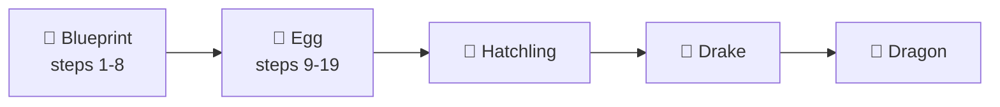

# 🗺️ Roadmap: Aurelius

> Status read from the step issues on 2026-11-22. ✅ closed, ⬜ open. Step n is issue #(n+2).

## 🧭 Phases

## 📘 Blueprint

| Step | Title | Issue | Status |
|---|---|---|---|
| 1 | Research map | [#3](https://github.com/SoulCraft-Org/aurelius/issues/3) | ✅ |
| 2 | The spec | [#4](https://github.com/SoulCraft-Org/aurelius/issues/4) | ✅ |
| 3 | Design: the seat | [#5](https://github.com/SoulCraft-Org/aurelius/issues/5) | ✅ |
| 4 | Training | [#6](https://github.com/SoulCraft-Org/aurelius/issues/6) | ✅ |
| 5 | Ladder | [#7](https://github.com/SoulCraft-Org/aurelius/issues/7) | ✅ |
| 6 | Hero: animated tree | [#8](https://github.com/SoulCraft-Org/aurelius/issues/8) | ✅ |
| 7 | Front door | [#9](https://github.com/SoulCraft-Org/aurelius/issues/9) | ⬜ |
| 8 | Public roadmap | [#10](https://github.com/SoulCraft-Org/aurelius/issues/10) | ⬜ |

## 🥚 Egg

| Step | Title | Issue | Status |
|---|---|---|---|
| 9 | Lair core: event loop | [#11](https://github.com/SoulCraft-Org/aurelius/issues/11) | ⬜ |
| 10 | Tasks | [#12](https://github.com/SoulCraft-Org/aurelius/issues/12) | ⬜ |
| 11 | Stand-in workers | [#13](https://github.com/SoulCraft-Org/aurelius/issues/13) | ⬜ |
| 12 | Seat + rule-based seat | [#14](https://github.com/SoulCraft-Org/aurelius/issues/14) | ⬜ |
| 13 | Ledger | [#15](https://github.com/SoulCraft-Org/aurelius/issues/15) | ⬜ |
| 14 | Baselines | [#16](https://github.com/SoulCraft-Org/aurelius/issues/16) | ⬜ |
| 15 | The 8 metrics | [#17](https://github.com/SoulCraft-Org/aurelius/issues/17) | ⬜ |
| 16 | Ladder runner | [#18](https://github.com/SoulCraft-Org/aurelius/issues/18) | ⬜ |
| 17 | Quality page learns the code | [#19](https://github.com/SoulCraft-Org/aurelius/issues/19) | ⬜ |
| 18 | First scores, sim | [#20](https://github.com/SoulCraft-Org/aurelius/issues/20) | ⬜ |
| 19 | Untrained Qwen3.5-9B seat | [#21](https://github.com/SoulCraft-Org/aurelius/issues/21) | ⬜ |

## 🔭 Later

| Phase | What | Needs first | Source, read 2026-11-22 |
|---|---|---|---|
| 🐣 Hatchling | First task: the bake-off (Inkling 2 Mini, MiMo distill). Then first training, on 47 real workers | Egg scores; budget asked first | [spec](../spec/aurelius.json) |
| 🚀 Release | Weights on Hugging Face, a GGUF file, `ollama run` | A trained seat | [training](training.md) |
| 🐲 Drake | 2,209 agents, 47 stand-in teams | Hatchling runs | [spec](../spec/aurelius.json) |
| 🐉 Dragon | 103,823 agents, 47 stand-in armies | Drake runs | [spec](../spec/aurelius.json) |

Rung sizes: [ladder](ladder.md).

## ❓ Questions and where each is answered

| # | Area | Question | Answer |
|---|---|---|---|
| 1 | 🗺️ Tasks | How a goal becomes a task graph, and how small a task should be | [design](design.md) |
| 2 | 🌳 Hierarchy | How many agents one orchestrator can watch, and when to add a layer | [design](design.md) |
| 3 | ✅ Review | How to check results at scale: every one, or a sample | [training](training.md), [ladder](ladder.md) |
| 4 | 💰 Budget | Limits per goal on time, tokens and compute | [design](design.md), [training](training.md) |
| 5 | 🔁 Failure | When to retry, raise effort, change model or stop | [design](design.md) |
| 6 | 👀 View | One board that shows the whole at a glance | [design](design.md) |
| 7 | 🧑 People | Where a person must decide, and how they are asked | [design](design.md) |
