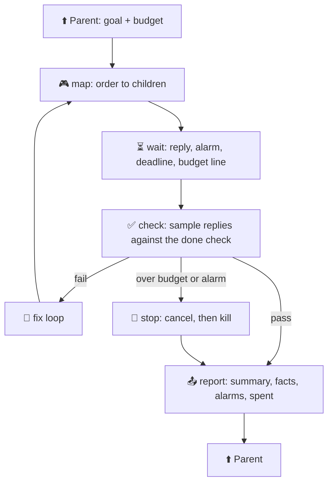

# 🌳 The seat

Design only: nothing is built or trained yet.

Sources: [`spec/aurelius.json`](../spec/aurelius.json) (spec) and [`docs/sources.md`](sources.md) (sources). Every figure names its source. All read 2026-11-22.

## 🔁 The loop

## 🌳 The tree

| Part | Value | Source |
|---|---|---|
| Span | 47 children per seat | [spec](../spec/aurelius.json) |
| Tiers | 3 | [spec](../spec/aurelius.json) |
| Workers | 47 × 47 × 47 = 103,823 | [spec](../spec/aurelius.json) |
| Seats | 2,257 | [spec](../spec/aurelius.json) |
| Why 47 | 47 × 47 × 47 = 103,823 workers (spec). One orchestrator holds 100 (K2.5) to 300 (K2.6) sub-agents, a figure Kimi states about itself | [Kimi K2.6](https://kimi.com/blog/kimi-k2-6), [arXiv 2602.02276](https://arxiv.org/abs/2602.02276) |
| Down | Goals and budgets | [spec](../spec/aurelius.json) |
| Up | Summaries and alarms | [spec](../spec/aurelius.json) |
| Run | Event-driven: a seat acts on a reply, an alarm, a deadline or a budget line | [spec](../spec/aurelius.json) |
| Idea taken | Planners hand work to sub-planners; workers stay isolated | [Cursor](https://cursor.com/blog/scaling-agents) |

## 🎮 The 5 actions

| Action | Does | Args | Source |
|---|---|---|---|
| `map` | Sends one order to many children; picks the cheapest worker type expected to pass | order, children, worker_type | [spec](../spec/aurelius.json) |
| `check` | Samples replies and tests them against the done check | children, sample | [spec](../spec/aurelius.json) |
| `wait` | Sleeps until a reply, an alarm, a deadline or a budget line | until | [spec](../spec/aurelius.json) |
| `stop` | Cancels children, then kills any still running after the grace period | children, grace_s | [spec](../spec/aurelius.json) |
| `report` | Sends a summary, facts and alarms to the parent | summary, facts, alarms, spent | [spec](../spec/aurelius.json) |

A learned router is planned. One paper reports up to 31.7% lower cost at equal quality ([arXiv 2601.07206](https://arxiv.org/abs/2601.07206)); not measured here. A cheaper call is not a cheaper finished task ([Switchyard](https://github.com/NVIDIA-NeMo/Switchyard)).

## 📝 The order (5 fields)

| Field | Type | Means | Source |
|---|---|---|---|
| `goal` | string | What done looks like, in one line | [spec](../spec/aurelius.json) |
| `done_check` | string | The test the reply must pass | [spec](../spec/aurelius.json) |
| `scope` | string | What the worker may touch; everything else is out | [spec](../spec/aurelius.json) |
| `reply_shape` | object | The fields the reply must carry | [spec](../spec/aurelius.json) |
| `budget` | object | Tokens, seconds and credits; the seat enforces it | [spec](../spec/aurelius.json) |

Idea taken: a recipe carries a reply schema and checks that must pass ([Goose](https://github.com/aaif-goose/goose)).

## 📬 The reply

| Field | Means | Source |
|---|---|---|
| `status` | `working`, `input_required`, `completed`, `failed` or `cancelled` | [spec](../spec/aurelius.json), [MCP Tasks](https://modelcontextprotocol.io/specification/draft/basic/utilities/tasks) |
| `facts` | Each fact tagged `seen` or `inferred`, with its source | [spec](../spec/aurelius.json), [Graphify](https://github.com/Graphify-Labs/graphify) |
| `alarms` | Anything the parent must know now | [spec](../spec/aurelius.json) |
| `spent` | Tokens, seconds and credits used. Unknown spend is never zero | [spec](../spec/aurelius.json) |

A chain of facts is only as strong as its weakest link ([Graphify](https://github.com/Graphify-Labs/graphify)).

## 🗂️ The board

| Part | Rule | Source |
|---|---|---|
| Look first | Ask whether a thing is needed before ordering it | [PonyTail](https://github.com/DietrichGebert/ponytail) |
| Ledger | One per seat, so a killed seat can resume | [Superpowers](https://github.com/obra/superpowers) |
| Why | In-process teammates cannot be resumed today | [Claude Code agent teams](https://code.claude.com/docs/en/agent-teams) |

## 🔧 The fix loop

| Step | Does | Source |
|---|---|---|
| 1 | Same worker tries again, up to 3 tries | [spec](../spec/aurelius.json) |
| 2 | A fresh worker, one type stronger | [spec](../spec/aurelius.json) |
| 3 | Park it with a ruling | [spec](../spec/aurelius.json) |

Idea taken: a capped fix loop with a fresh worker ([Superpowers](https://github.com/obra/superpowers)).

## 🔌 Works with

| Wire | Detail | Source |
|---|---|---|
| ACP over stdio | One wire for every worker. 51 agents listed, OpenCode, Goose, Gemini CLI and Codex CLI among them. v1 stable; v2 in preview since 2026-11-20 | [Agent Client Protocol](https://agentclientprotocol.com) |
| Exec shim | A small shim for agents without ACP | our design |
| Adapter | Planned for the first trained rung; not built yet | our plan |

## 🛡️ Safety

| Rule | Detail | Source |
|---|---|---|
| Budgets | The seat enforces every budget. Orders that spend past theirs are counted, goal 0 | [spec](../spec/aurelius.json) |
| Permissions | `allow`, `ask` or `deny`; the last match wins; default `ask` | [spec](../spec/aurelius.json), [OpenCode](https://github.com/anomalyco/opencode) |
| Stop | Cancel, then kill after `grace_s` | [spec](../spec/aurelius.json) |
| Human gate | A person decides: spend, irreversible, outward | [spec](../spec/aurelius.json) |

## 🎚️ The dial

| Weight | Default | Source |
|---|---|---|
| Quality | 1 | [spec](../spec/aurelius.json) |
| Cost | 1 | [spec](../spec/aurelius.json) |
| Speed | 1 | [spec](../spec/aurelius.json) |

Balanced by default. Relative weights. Each goal can override. Cost and speed pay only when the task is solved ([arXiv 2511.21689](https://arxiv.org/abs/2511.21689)).
