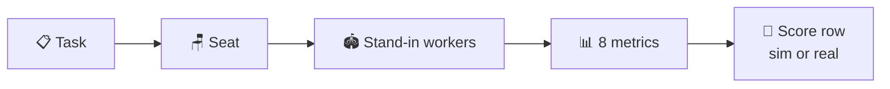

# 📏 The Lair and the Ladder

The Lair simulates workers on a CPU. The Ladder scores a seat on the Lair, rung by rung.

> 🚧 **No score exists yet.** Numbers come from the spec or the cited sources. Spec rates marked assumed stay so until real runs replace them.

Sources: [`spec/aurelius.json`](../spec/aurelius.json) and [`docs/sources.md`](sources.md), both read 2026-11-22.

## 🏟️ The Lair

A CPU simulator of stand-in workers. No model runs in it.

| Part | What it does | Source, read 2026-11-22 |
|---|---|---|
| Typed workers | Each has a price, a skill and a time: small 1 credit, 0.6, 2 s. Medium 4, 0.8, 4 s. Large 16, 0.93, 8 s | `spec/aurelius.json`, `worker_types`: assumed |
| Noisy check | False pass 0.05, false fail 0.05 | `spec/aurelius.json`, `check`: assumed until fitted from real runs |
| Crashes | A stand-in can die mid-order, so resume gets tested | `spec/aurelius.json`, metric `resume_rate` |
| Fitting | Recorded real runs replace every assumed rate | `spec/aurelius.json`, `comment` |
| Precedent | Dummy workers made 1M agents cost about 40 s | [arXiv 2407.17789](https://arxiv.org/abs/2407.17789) |

## 🪜 The 4 rungs

Source: `spec/aurelius.json`, `rungs` and `tree`, read 2026-11-22.

| Rung | Agents | Tiers | Seats |
|---|---|---|---|
| `r10` | 10 | 1 | 1 |
| `r47` | 47 | 1 | 1 |
| `r2209` | 2,209 | 2 | 48 |
| `r103823` | 103,823 | 3 | 2,257 |

A seat has up to 47 children (`tree.span`); `r10` has 10.

## 📊 The 8 metrics

Source: `spec/aurelius.json`, `metrics`, read 2026-11-22.

| Metric | Unit | Better | Means |
|---|---|---|---|
| ⭐ `cost_per_verified_success` | credits | lower | all credits spent divided by verified successes. **The headline** |
| `verified_success` | % | higher | tasks whose done check passes on a fresh check |
| `critical_steps` | steps | lower | seat steps plus the longest child branch, per stage |
| `error_growth_per_tier` | x | lower | wrong-fact rate a tier sends up, divided by the rate it received |
| `alarms_reaching_top` | % | higher | planted alarms that reach the root seat |
| `fake_split_rate` | % | lower | splits that do not shorten the critical path |
| `resume_rate` | % | higher | killed seats that resume to the same result |
| `budget_overruns` | count | lower | orders that spent past their budget. Goal: 0 |

## 🧱 The 3 baselines

Source: `spec/aurelius.json`, `baselines`, read 2026-11-22.

| Baseline | Means |
|---|---|
| `one_agent` | one large worker does the whole task alone |
| `flat_fan_out` | one seat sends every item to its own medium worker; no tiers, no checks |
| `cheapest_that_passes` | flat fan-out, each item to the cheapest type whose skill clears the bar |

## 🚪 Gates

No targets yet. Each rung's targets come from the 3 baselines run on that same rung, not from guesses.

| Step | Target |
|---|---|
| 1. Run the 3 baselines on every rung in the Lair | none yet |
| 2. Read the 8 metrics off those runs | none yet |
| 3. Set each rung's targets from them | set after step 2 |

## 🧾 The score row

Source: `spec/aurelius.json`, `score_row`, read 2026-11-22.

| Field | Value |
|---|---|
| Fields | `date`, `commit`, `rung`, `seat`, `workers`, `seed`, `metrics` |
| `workers` | `sim` or `real` |

**Every score says `sim` or `real`.** A sim score never stands in for a real one.

## 🔀 One run

## 🔎 Why a new Ladder

| Finding | Source |
|---|---|
| No published benchmark we found tests 100+ agents. Searched 2026-11-22 | our search, not a cited source |
| The agent count in vendor claims is 100 sub-agents (K2.5) and 300 (K2.6), stated by the vendor | [arXiv 2602.02276](https://arxiv.org/abs/2602.02276), [Kimi K2.6](https://kimi.com/blog/kimi-k2-6), read 2026-11-22 |
| Teams in the error-growth study reach 9 agents | [arXiv 2512.08296](https://arxiv.org/abs/2512.08296), read 2026-11-22 |
| A scoreboard of cost and time to a target is a known pattern | [nanochat](https://github.com/karpathy/nanochat), read 2026-11-22 |
