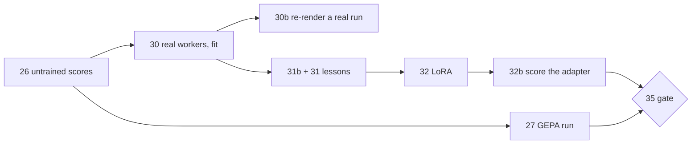

# 🐣 Hatchling: what is left (handoff, 2026-11-23)

The code for steps 20 to 32 is merged. What is left is mostly runs on GPUs, then the gate. Every run goes through `train/guard.py` first and writes one row to `ladder/spend.jsonl`.

## ✅ Done

| Steps | What |
|---|---|
| 20, 21, 21b, 21c, 22, 23, 24, 25, 28, 29, 30c | Merged and closed |
| 26, 27, 30, 30b, 31, 32 | Code merged; the run or the data PR is left |
| Move 3 (step 24) | Swept rule seat (bar 0.5, sample 1.0) kept: share of items right +0.131 on r10 and +0.116 on r47, 100 val seeds, sim with assumed rates ([#90](https://github.com/SoulCraft-Org/aurelius/pull/90)) |
| Smoke (step 25) | Untrained Qwen3.5-9B seat ran end to end on one L4: 560 GPU seconds, 0 format errors, r10 dev seed 0, sim workers (run `2026-11-23T175228Z-smoke`, row in `ladder/spend.jsonl`) |

## 🗺️ Run order

## 📋 Steps left

| # | Do | How | Gate |
|---|---|---|---|
| 26 | Score the untrained seat: Qwen3.5-9B free-form, Qwen3.5-9B locked, MiMo distill; r10 and r47; val seeds 1000 to 1099 | `train/serve.py score --job r10:val:1000-1099 --job r47:val:1000-1099` (add `:lock`, or `--model mimo-9b`); measure one r47 job first | Rows in `ladder/scores.json` with stamps; a README chart of score by seat; format errors decide whether the lock stays |
| 30 | Record real workers (small, medium, large; brief terse and full) on dev Libraries, fit their rates | `train/serve.py workers --kind ... --brief ...`, then `lair/fit.py` | Spec `worker_types` marked fitted with the date; sim-vs-real gap table in `docs/ladder.md` |
| 30b | Re-render the animated run and the viewer from one recorded real run | `tools/make_run_svg.py`, `tools/make_viewer_data.py` | Captions say real, with the run id |
| 31b | New code: the student's own transcripts, best-of-N on dev seeds ([#117](https://github.com/SoulCraft-Org/aurelius/issues/117)) | `train/serve.py` job | Lines in the shape `train/traces.py` reads |
| 31 | Build the lessons: swept rule seat transcripts plus 31b, dev seeds only | `python3 -m train.traces IN OUT --min-reward 0.9`; upload under `lessons/dev/` | Counts kept and dropped, in the PR |
| 32 | LoRA tune, r10 then r47 | `train/sft.py run --lessons lessons/dev/<file> --rank 16` (L40S, worst case under $3) | Adapter hash recorded |
| 32b | New code: serve a LoRA adapter so the tuned seat can be scored ([#118](https://github.com/SoulCraft-Org/aurelius/issues/118)) | `train/serve.py` | Rows stamped with the adapter hash |
| 27 | GEPA run on the seat prompt, dev seeds inside the loop | `train/gepa_seat.py` | Kept only if the 95% interval of the gain on 100 paired val seeds is above 0 (`ladder/stats.py`) |
| 33, 34 | GRPO only if 32 stalls; blend only with 2 or more kept adapters | `train/grpo.py`, `train/blend.py` (not written yet) | Same keep rule |
| 35 | The gate: test seeds opened once | Trained seat vs untrained vs swept rule seat vs baselines, real workers and sim with rates moved ±20% | README scoreboard, `docs/training.md` results, this roadmap marks the outcome |

## 🧹 Small follow-ups from reviews

| Where | Fix |
|---|---|
| `ladder/sweep.py` | Add cost per verified success to the printed table |
| `.github/workflows/ladder.yml` | Mention the `sweep` input in the header comment |
| `docs/viewer/index.html` | Disable Play and the slider until `run.json` loads; say simulated in the heading |
| `tools/make_tree.py` | Read the top seat count instead of assuming one |
| `ladder/models.py` | Restrict where `SEAT_PROMPT_FILE` may point |
| `ladder/run.py` | Duplicate keys in one check are charged twice |
| `spec/aurelius.json`, `lair/fit.py`, `lair/real_workers.py` | Add `brief` to the reply fields; group by `reply["brief"]`; build the order from `spec["order"]` |
| `train/gepa_seat.py` | Fence the reflector's reply before it becomes the prompt |

## 💰 Compute

| Lane | Rule |
|---|---|
| GPU jobs | `train/guard.py` refuses a job past the month's spend cap or the credit floor it names; give `MODAL_LIMIT_CHECKED` the month only after checking the provider's usage limit that month |
| Every run | One `ladder/spend.jsonl` row, committed with its scores; billed must stay $0.00 |
