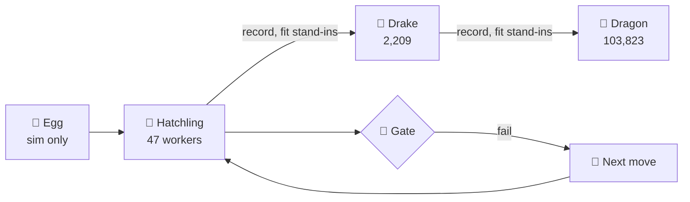

# 🐉 How to train your dragon

How the seat model is trained, rung by rung. Every source below was read on 2026-11-23, unless a row says otherwise. Figures marked "our estimate" are ours. 🗣️ marks a score the vendor states about its own work.

> ⚠️ **Nothing here is trained yet.** This page is the plan. The first sim scores, for a rule-based seat and three baselines, are on the [README scoreboard](../README.md#-scoreboard). No model score exists yet.

## 🧗 The climb

One seat trains per episode. Its 47 children are frozen. The seat trains in a Lair fitted from real workers, and real workers are the exam. Each rung's recorded runs are fitted into the stand-ins the next rung uses.

| Rung | Agents | Seats | Trains in | Exam | Source |
|---|---|---|---|---|---|
| 🥚 Egg | 10 to 103,823 | 1 to 2,257 | nothing trained | sim | [spec](../spec/aurelius.json) |
| 🐣 Hatchling | 47 | 1 | Lair fitted from real workers | real workers | [spec](../spec/aurelius.json) |
| 🐲 Drake | 2,209 | 48 | Lair with 47 team stand-ins | one real team | [spec](../spec/aurelius.json) |
| 🐉 Dragon | 103,823 | 2,257 | Lair with 47 army stand-ins | one real team in the tree | [spec](../spec/aurelius.json) |

## 🧰 The 9 moves

Cheapest move first. A move stays only if its gain on unseen seeds is above 0.

| # | Move | Tool | Evidence | Source |
|---|---|---|---|---|
| 1 | 📏 Measure the untrained seat | the Ladder | No number, no claim | [spec](../spec/aurelius.json) |
| 2 | 🔒 Lock tool calls to the 5 actions | vLLM structured output | No gain figure read yet. Kept only if format errors show up in step 26 | [vLLM](https://docs.vllm.ai/en/latest/features/structured_outputs/) |
| 3 | 🧹 Sweep the rule seat's two knobs | stdlib grid | A stronger baseline, and free lessons | our plan |
| 4 | ✍️ Evolve the seat prompt in the Lair | GEPA | On its paper's tasks, about 6% above GRPO. Up to 35x fewer rollouts | [arXiv 2507.19457](https://arxiv.org/abs/2507.19457) |
| 5 | 🎓 Tune: LoRA on the best runs, rung 10 then 47 | PEFT | LoRA matched full fine-tuning on small and medium SFT sets. Its RL tests were on reasoning, not agent tool use. | [Thinking Machines](https://thinkingmachines.ai/blog/lora/) |
| 6 | 🏋️ Reinforce: GRPO in the fitted Lair | HF TRL, 1 GPU | Only if move 5 stalls | [TRL](https://huggingface.co/docs/trl/main/en/grpo_trainer) |
| 7 | 🧪 Blend the best adapters | mergekit | Thin for agents: only with 2 or more kept adapters | [arXiv 2403.13257](https://arxiv.org/abs/2403.13257) |
| 8 | ⬆️ Upgrade the base: same recipe on the 27B | moves 1 to 7 | Must beat the 9B on unseen seeds | [Qwen3.8-27B](https://huggingface.co/Qwen/Qwen3.8-27B) |
| 9 | 🔄 Update: replay old rungs, re-score every release file, playbook from logged runs | the Ladder | Quantized files are scored, never assumed equal | [arXiv 2510.04618](https://arxiv.org/abs/2510.04618) |

| ❌ Named, then skipped | Why | Source |
|---|---|---|
| Steering vectors | Prompting beat every steering method | [AxBench, arXiv 2501.17148](https://arxiv.org/abs/2501.17148) |
| Fact editing (ROME, MEMIT) | Edits facts, not skills | [ROME](https://arxiv.org/abs/2202.05262), [MEMIT](https://arxiv.org/abs/2210.07229) |
| DPO | No multi-step tool-use evidence in hand | our plan |
| Moving an adapter to a new base | No agent evidence: re-run the recipe instead | our plan |

## 🗺️ Moves × rungs

| Move | 🐣 47 | 🐲 2,209 | 🐉 103,823 | 🚀 Release |
|---|---|---|---|---|
| 1 Measure | ✅ sim + real | ✅ sim | ✅ sim + 1 real team | ✅ |
| 2 Lock | ✅ if needed | carried | carried | ✅ |
| 3 to 4 Evolve | ✅ | re-run per tier | re-run per tier | |
| 5 Tune | ✅ | + replay | + replay | 27B |
| 6 Reinforce | if 5 stalls | ✅ | ✅ | 27B |
| 7 Blend | if 2+ adapters | same | same | |
| 8 Upgrade base | | | | ✅ |
| 9 Update | | ✅ | ✅ | ✅ every file |

## 🔀 Order

| Order | What | Why |
|---|---|---|
| 1 | Prompts: moves 3 and 4 | Change a mind at the shallowest depth that works, and train last ([issue #60](https://github.com/SoulCraft-Org/aurelius/issues/60), ask 3) |
| 2 | Lessons: rule-seat transcripts and the student's best-of-N runs, kept by Lair score | Open-weight sources only |
| 3 | LoRA: move 5 | One GPU is the plan for rung 47; not measured yet. |
| 4 | GRPO: move 6, only if LoRA stalls | The costliest move |

## 🧠 Students

Hatchling's first task is a bake-off. The winner takes the slot.

| Slot | Model | Licence | Source |
|---|---|---|---|
| Iterate | Qwen/Qwen3.5-9B, 262k context | Apache-2.0 | [Hugging Face](https://huggingface.co/Qwen/Qwen3.5-9B) |
| Release | Qwen/Qwen3.8-27B, 27.8B parameters | Apache-2.0 | [Hugging Face](https://huggingface.co/Qwen/Qwen3.8-27B) |
| Bake-off, release | thinkingmachines/Inkling-2-Mini | Apache-2.0; links an Acceptable Use Policy, read before use | [Hugging Face](https://huggingface.co/thinkingmachines/Inkling-2-Mini) |
| Bake-off, iterate | XiaomiMiMo/MiMo-V2.6-Distill-Qwen-9B | MIT | [Hugging Face](https://huggingface.co/XiaomiMiMo/MiMo-V2.6-Distill-Qwen-9B) |
| ❌ Never | nvidia/Nemotron-Orchestrator-8B | NVIDIA License, non-commercial research only | [arXiv 2511.21689](https://arxiv.org/abs/2511.21689) |

## 🧰 Stack

| Part | Choice | Licence | Source |
|---|---|---|---|
| Trainer | Hugging Face TRL on 1 GPU first | Apache-2.0 | [TRL](https://huggingface.co/docs/trl/main/en/grpo_trainer) |
| Trainer, later | NVIDIA NeMo RL, only with an 8-GPU node | Apache-2.0 | [GitHub](https://github.com/NVIDIA-NeMo/RL) |
| Judge | Deferred: these tasks grade themselves | | our plan |
| Evals | Inspect AI, runs in CI | MIT | [GitHub](https://github.com/UKGovernmentBEIS/inspect_ai) |

## 🎯 Reward and tasks

| Rule | Detail | Source |
|---|---|---|
| Reward | The share of items right. A reply that does not parse scores 0 | [spec](../spec/aurelius.json) |
| Report | "Verified" at the 95% bar | [spec](../spec/aurelius.json) |
| Split bonus | Only on tasks that can split, and only on success; it fades to 0 | [spec](../spec/aurelius.json) `reward[split]`, [arXiv 2602.02276](https://arxiv.org/abs/2602.02276) |
| Tasks | Fill-the-table research with known answers; planted faults and alarms | [spec](../spec/aurelius.json) |
| Tasks where splitting is wrong | Sequential planning got 39% to 70% worse with more agents | [arXiv 2512.08296](https://arxiv.org/abs/2512.08296) |

## 💰 Compute

Free and subscription credits only, no pay per use (owner's rule, 2026-11-23). Every job passes a guard first: it reads the credit left, refuses past the cap and sets a hard timeout. Every run adds a ledger row of GPU-seconds at list price.

| Tier | Lane | Used for |
|---|---|---|
| 0 | GitHub Actions, CPU | Lair runs, sweeps, tests |
| 1 | Modal's monthly credit, shared with other work | serve, measure, evolve, real workers, LoRA |
| 1 | Hugging Face PRO | backup evals; hosting weights and data |
| 2 | Later: a cloud trial, an AMD credit | GRPO, the 27B |
| 3 | Later: a research grant | training through 🚀 |
| 4 | Later: startup programs | 🚀 and 🔄 |

| Wave | Estimated credit | Source |
|---|---|---|
| 🧬 Evolve | about $5 | our estimate, [Modal list prices](https://modal.com/pricing), 2026-11-23 |
| 🌍 Reality | about $8 | our estimate, [Modal list prices](https://modal.com/pricing), 2026-11-23 |
| 🎓 Lessons and LoRA, no GRPO | about $10 | our estimate, [Modal list prices](https://modal.com/pricing), 2026-11-23 |

These are credit, not money billed. Our goal: billed reads $0.00 after every run.

## 📦 Hosting rule

| Rule | Why | Source |
|---|---|---|
| Open weights only | Their licences allow it | model cards above |
| Pinned US or EU hosts, data collection off | Our own rule | our rule |
| Never a model maker's own API from China | Our own rule | our rule |
| No closed model (Claude, GPT, Gemini, Grok) writes or grades training data | Their terms bar training on outputs. Anthropic's Usage Policy lists it as platform abuse unless Anthropic approves it in advance | [Anthropic](https://www.anthropic.com/legal/aup), [OpenAI](https://openai.com/policies/row-terms-of-use/), [Google](https://ai.google.dev/gemini-api/terms) |

## 🔁 Keep or reset, and the gate

| Rule | Detail |
|---|---|
| Keep or reset | At least 100 paired val seeds. A move stays only if the 95% interval of its gain (our rule) is above 0. Every keep and reset is logged |
| Seeds | Dev, val and test never mix. Test seeds open once, at the gate. Never pick moves on the real exam |
| Search loops | Keep the scorer out of the loop's reach ([Cerebras](https://www.cerebras.ai/blog/how-to-stop-your-autoresearch-loop-from-cheating)) |
| 🏁 Hatchling gate | The trained seat beats the untrained seat and the swept rule seat, on real workers. It also holds with the Lair's rates moved ±20% (our test) |
| Not claimed | Brief writing: stand-in workers ignore the brief's text, so the Lair cannot score it |

## 🚀 Release

Weights on Hugging Face, the release-slot winner. A GGUF plus a Modelfile, so `ollama run` works ([Ollama import](https://docs.ollama.com/import)). Used from [OpenCode](https://github.com/anomalyco/opencode), [Goose](https://github.com/aaif-goose/goose) and [Zed](https://github.com/zed-industries/zed). Ship the smallest file within 2 points of the release file on val seeds.
