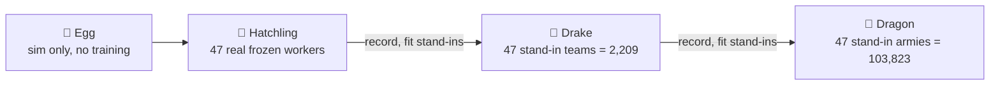

# 🐉 How to train your dragon

How the seat model is trained, rung by rung. Every source below was read on 2026-11-22. Figures marked "our estimate" are ours. 🗣️ marks a score the vendor states about its own model.

> ⚠️ **Nothing here is trained yet.** This page is the plan. The first sim scores, for a rule-based seat and three baselines, are on the [README scoreboard](../README.md#-scoreboard). No model score exists yet.

## 🧗 The climb

One seat trains per episode. Its 47 children are frozen. Each rung's recorded runs are fitted into the stand-ins the next rung uses. The full tree runs only for tests.

| Rung | Agents | Tiers | Seats | Trains against | Source, read 2026-11-22 |
|---|---|---|---|---|---|
| 🥚 Egg | 10, 47, 2,209, 103,823 | 1 to 3 | 1 to 2,257 | nothing trained | [spec](../spec/aurelius.json) |
| 🐣 Hatchling | 47 | 1 | 1 | 47 real frozen workers | [spec](../spec/aurelius.json) |
| 🐲 Drake | 2,209 | 2 | 48 | 47 stand-ins fitted from Hatchling | [spec](../spec/aurelius.json) |
| 🐉 Dragon | 103,823 | 3 | 2,257 | 47 stand-ins fitted from Drake | [spec](../spec/aurelius.json) |

Gate targets come from the Egg's baseline scores, not from guesses made now.

## 🧠 Students

Hatchling's first task is a bake-off. The winner takes the slot.

| Slot | Model | Licence | Source, read 2026-11-22 |
|---|---|---|---|
| Iterate | Qwen/Qwen3.5-9B, 262k context | Apache-2.0 | [Hugging Face](https://huggingface.co/Qwen/Qwen3.5-9B) |
| Release | Qwen/Qwen3.8-27B, 27.8B parameters | Apache-2.0 | [Hugging Face](https://huggingface.co/Qwen/Qwen3.8-27B) |
| Bake-off, release slot | thinkingmachines/Inkling-2-Mini | Apache-2.0 plus a use policy that binds derivatives | [Hugging Face](https://huggingface.co/thinkingmachines/Inkling-2-Mini) |
| Bake-off, iterate slot | XiaomiMiMo/MiMo-V2.6-Distill-Qwen-9B, same architecture as Qwen3.5-9B | MIT | [Hugging Face](https://huggingface.co/XiaomiMiMo/MiMo-V2.6-Distill-Qwen-9B) |
| ❌ Never | nvidia/Nemotron-Orchestrator-8B | NVIDIA License, non-commercial research only | [arXiv 2511.21689](https://arxiv.org/abs/2511.21689) |

## 🎓 Teacher and judge

| Job | Model | Licence | Note | Source, read 2026-11-22 |
|---|---|---|---|---|
| Teacher, writes the warm-up examples | deepseek-ai/DeepSeek-V4.1-Flash | MIT | Terminal-Bench 2.1 90.6 🗣️ | [Hugging Face](https://huggingface.co/deepseek-ai/DeepSeek-V4.1-Flash) |
| Teacher fallback | zai-org/GLM-5.3 | not read | | [Hugging Face](https://huggingface.co/zai-org/GLM-5.3) |
| Judge, grades practice runs | nvidia/NVIDIA-Nemotron-3-Ultra-550B-A55B | OpenMDW-1.1, the only licence found that explicitly frees outputs | A different family from the teacher | [Hugging Face](https://huggingface.co/nvidia/NVIDIA-Nemotron-3-Ultra-550B-A55B-BF16), [licence](https://openmdw.ai/license/1-1/) |

The judge is calibrated on about 300 hand-ranked run pairs before RL. Its GenRM variant is self-hosted later.

## 🔧 Method

| Step | What | Source, read 2026-11-22 |
|---|---|---|
| 1 | SFT warm-up on DeepSeek-V4.1-Flash examples | our plan |
| 2 | Calibrate the judge on about 300 hand-ranked run pairs | our plan |
| 3 | GRPO, one seat at a time, children frozen, runs graded by the judge | [arXiv 2511.21689](https://arxiv.org/abs/2511.21689), [arXiv 2602.02276](https://arxiv.org/abs/2602.02276) |
| 4 | Split and finish bonuses fade to 0 | [arXiv 2602.02276](https://arxiv.org/abs/2602.02276) |

## 🎯 Reward

| Term | Kind | When | Rule | Source, read 2026-11-22 |
|---|---|---|---|---|
| Format | gate | always | An action that does not parse scores 0 | [spec](../spec/aurelius.json) |
| Success | base | always | The done check passes, as far as the seat can see | [spec](../spec/aurelius.json) |
| Cost | bonus | on success only | Credits left under budget | [spec](../spec/aurelius.json), [arXiv 2511.21689](https://arxiv.org/abs/2511.21689) |
| Speed | bonus | on success only | Critical steps left under budget | [spec](../spec/aurelius.json), [arXiv 2511.21689](https://arxiv.org/abs/2511.21689) |
| Split | bonus | on success, task can split | Weight 0.1, fades to 0 during training | [spec](../spec/aurelius.json), [arXiv 2602.02276](https://arxiv.org/abs/2602.02276) |

Weights for cost and speed come from the dial (quality, cost, speed; default balanced). Credit comes only from what the seat can see. Each sub-agent's credit can be gated by a rubric score of its report ([arXiv 2611.17041](https://arxiv.org/abs/2611.17041), read 2026-11-22).

## 📋 Tasks

| Kind | Why | Source, read 2026-11-22 |
|---|---|---|
| Fill-the-table research with known answers | Success is checkable | our plan |
| Planted faults and alarms | Tests whether alarms reach the root seat | [spec](../spec/aurelius.json) |
| Tasks where splitting is wrong | Sequential work gets worse with more agents: 39% to 70% worse on sequential planning | [arXiv 2512.08296](https://arxiv.org/abs/2512.08296) |

## 📦 Hosting rule

| Rule | Why | Source, read 2026-11-22 |
|---|---|---|
| Open weights only | Their licences allow it | model cards above |
| Pinned US or EU hosts, data collection off | Our own rule | our rule |
| Never a model maker's own API from China, for example Alibaba Cloud for Qwen or DeepSeek's platform | Our own rule | our rule |
| No closed model (Claude, GPT, Gemini, Grok) writes or grades training data | Their terms bar training on outputs. Anthropic: none "without prior authorization from Anthropic" | [Anthropic](https://www.anthropic.com/legal/aup), [OpenAI](https://openai.com/policies/row-terms-of-use/), [Google](https://ai.google.dev/gemini-api/terms) |

## 🧰 Stack

| Part | Choice | Licence | Source, read 2026-11-22 |
|---|---|---|---|
| Trainer and environments | NVIDIA NeMo RL + NeMo Gym, ships a Qwen3.5-9B GRPO recipe | Apache-2.0 | [GitHub](https://github.com/NVIDIA-NeMo/RL) |
| Fallback | Hugging Face TRL AsyncGRPOTrainer v1.18.2, with its own vLLM server for generation | Apache-2.0 | [TRL docs](https://huggingface.co/docs/trl/main/en/async_grpo_trainer) |
| Evals | Inspect AI, runs in CI | MIT | [GitHub](https://github.com/UKGovernmentBEIS/inspect_ai) |

## 🚀 Release

| Piece | Detail | Source, read 2026-11-22 |
|---|---|---|
| Weights | Hugging Face, the release-slot winner | [Qwen3.8-27B](https://huggingface.co/Qwen/Qwen3.8-27B) |
| Local file | GGUF plus a Modelfile, so `ollama run` works. Ollama does not quantize on import | [Ollama import](https://docs.ollama.com/import) |
| Used from | OpenCode, Goose, Zed | [OpenCode](https://github.com/anomalyco/opencode), [Goose](https://github.com/aaif-goose/goose), [Zed](https://github.com/zed-industries/zed) |

## 🌙 Experiment loop

| Rule | Detail | Source, read 2026-11-22 |
|---|---|---|
| Fixed budget per run | Keep the change or reset it | [autoresearch](https://github.com/karpathy/autoresearch) |
| One metric | Cost per verified success is the headline | [spec](../spec/aurelius.json) |
| Capped | A cap on runs and a stop switch | [autoresearch](https://github.com/karpathy/autoresearch) (idea only) |

## 💰 Costs

| Item | Estimate | Note |
|---|---|---|
| 🥚 Egg | $0 | our estimate, 2026-11-22: simulator on CPU, nothing trained |
| 🐣 Hatchling | about $100 to $400 | our estimate, 2026-11-22 |
| 🐲 Drake | priced after Hatchling | Real runs set the price |
| 🐉 Dragon | priced after Drake | Real runs set the price |
| Teacher | about $750 | our estimate, 2026-11-22: 20,000 examples on DeepInfra |
| Judge | about $1,700 | our estimate, 2026-11-22: 100,000 graded runs at API rates |

For scale, one open project reports about 2 hours and $48 to reach GPT-2 grade, a figure its authors state about their own work ([nanochat](https://github.com/karpathy/nanochat), read 2026-11-22). It is a different task and proves nothing about ours.
